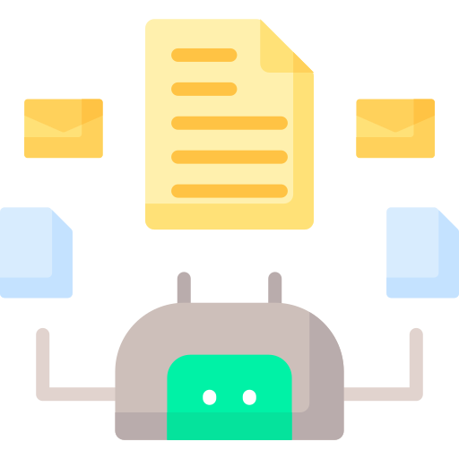

    

AI Agents Configuration

    
    
    
    
    
    

## 📖 About Agents

**_Agents_** is the version-controlled home for the rules, persona, skills, subagents, slash commands, hooks, and MCP server declarations that drive the AI agents in use on this machine: _OpenAI Codex CLI_, _Claude Code_, _OpenCode_, _Gemini CLI_, and _Hermes Agent_. The repository is self-installing — a single command on each supported operating system links the relevant files into each agent's dotfile directory and syncs the MCP servers and plugins, so every agent reads from the same canonical source. _Hermes Agent_ is configured through the Nix flake instead.

## 📚 Documentation

For detailed information on **_Agents_** installation and repository layout, please refer to the project's [Wiki](https://github.com/samariafar/agents/wiki). The Wiki provides comprehensive guides and resources to help you get started with **_Agents_** and make the most out of its features. Additionally, you can find answers to the most frequently asked questions (FAQs) in the Wiki.

## ⚖️ License

> Copyright © 2025–2026 [Sam Ariafar](mailto:me@samariafar.com)

**_Agents_** is distributed under the terms of the [MIT License](https://github.com/samariafar/agents/blob/main/LICENSE.md). Unless it is explicitly stated otherwise, any contribution intentionally submitted for inclusion in this project shall be licensed as _MIT_, without any additional terms or conditions.
